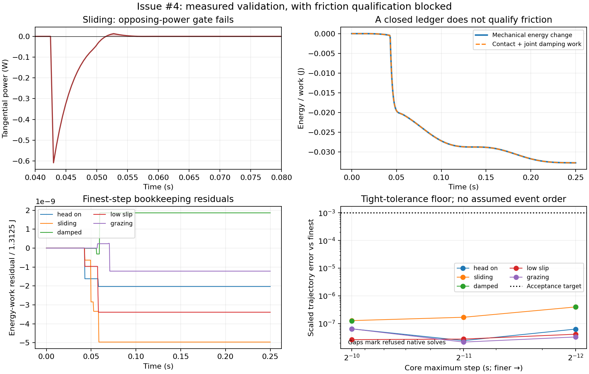

# Coupled contact validation: measured results and remaining blockers

This report continues Issue #4. **Friction qualification remains blocked.**
A correct force mapping and a closed energy-work ledger do not establish a
passive friction law. The original opposing-slip-power criterion is unchanged.
The implementation remains an experimental bus–bumper configuration.

## Reproduction and artifacts

Use the exact paired core/companion environment in
[the engine-coupling guide](../compliant_contact.md), then run:

```sh
CONTACT_VALIDATION_TEST_REPORT=/tmp/contact-validation/tests.toml \
  julia --startup-file=no --project=/tmp/contact-env test/runtests.jl
julia --startup-file=no --project=/tmp/contact-env \
  examples/validate_contact.jl /tmp/contact-validation
python3 examples/plot_contact_validation.py /tmp/contact-validation
```

The last command needs matplotlib. The simulator does not need Python.
`summary.toml` records source revisions, dirty flags, source-file SHA-256 hashes,
Julia/platform/native versions, solver/contact settings, fixed physical scales,
refinement results, physical-regularization sensitivity, and every failed gate.
`tests.toml` records rejection/replay, rotation and independent tolerance sweeps.
The five CSV files contain poses, velocities, both bodies' smooth and contact
COM wrenches, momentum, angular momentum, kinetic/joint energy, contact/friction
and joint-damping power, and cumulative work and impulse at common times.
Gravity potential, external work and actuation work are explicitly zero.

`validate_contact.jl` normally writes the complete evidence even when physical
qualification fails. Add `--require-qualified` for a strict gate: it currently
returns exit code 1. Native failures are recorded with the exact case and step
cap; they do not become successful trajectories. Unexpected analysis errors
still abort the command. Linux/macOS paired-core CI uploads the full report
folder. CI's two `@test_broken` assertions preserve the observed friction
counterexamples; an unexpected pass requires revisiting the evidence.

## Methods and bounded scope

Core integrates one 20 kg box and one 1 kg spherical bumper. The fixture retains
its isotropic, fixed-rest joint and small relative rotation. Diagnostics query
accepted trajectories with an independent runtime; rejected RHS stages never
supply output records. A fixed initial bus origin moving at constant initial
system COM velocity avoids large-position/boost energy cancellation. Axes stay
parallel to the inertial frame. Both physical bodies are summed once.

Joint elastic potential and midpoint-damping power are evaluated analytically.
The objective damping law merged in core #604 replaces the original plan's
noncentral-damping prerequisite; the nonzero-damping case now closes angular
momentum and work ledgers. Joint loads and contact loads remain separate in the
CSV. Contact power is checked both from world COM wrenches and native constraint
force times constraint velocity. Four-point Gauss work quadrature splits contact
onset/separation roots and is refined independently of the core trajectory.

Five 0.25-second cases cover head-on, off-center sliding, nonzero joint damping,
low slip and grazing near the box edge. Core maximum steps are `2^-10` through
`2^-13` s; the native timestep stays `2^-12` s. The default native time constant
is 0.01 s. A separate 0.005/0.01/0.02 s sweep changes the physical contact model;
it is not a numerical-convergence test. The existing two-second head-on example
remains a separate longer-run regression.

## Measurements on macOS arm64, Julia 1.12.1, MuJoCo 3.11.0

The original 157 coupling assertions still pass. The expanded suite adds 89
passing assertions and two recorded qualification failures. A near-touch
fixture forces 63 rejected steps; replay is bit-identical and its accepted
trajectory differs from the refined reference by `2.33e-8` in fixed scaled units.
A global rotation of 0.8 rad gives a maximum scaled trajectory difference of
`1.66e-8`, including bus displacement, relative position, velocities, orientations
and body angular rates.

Core tolerances `1e-6`, `1e-8`, `1e-10`, `1e-12` at a fixed `2^-10` s cap give
errors against the tightest run of `1.48e-4`, `1.13e-6`, `2.28e-8`.
Native timestep and solve-tolerance sweeps are independent. The tight core-step
sweep reaches an error floor; no monotone order of event convergence is claimed.

| Finest-step ledger | Maximum measured residual | Acceptance budget |
|---|---:|---:|
| Linear momentum | 1.22e-15 kg m/s | 5.25e-7 kg m/s |
| Angular momentum | 2.23e-15 kg m²/s | 5.25e-7 kg m²/s |
| Energy minus contact/damping work | 6.52e-9 J | 1.3125e-5 J |
| Contact-work quadrature refinement | 3.97e-9 J | 1.3125e-6 J |

These maxima describe completed finest-step runs, not the refused intermediate
run below. Exact values and source provenance are in the machine-readable
[short-run snapshot](contact_validation_macos.toml) and
[test measurements](contact_validation_tests_macos.toml). Effective restitution uses first geometric approach/departure normal
speeds and includes compliant-joint forces; it is not a configured material
restitution coefficient.

The [two-second snapshot](contact_validation_long_macos.toml) repeats the same
five cases over the longer horizon. Completed finest-step runs retain energy-work
residual below `6.52e-9 J`, linear momentum below `2.49e-15 kg m/s`, angular
momentum below `3.39e-15 kg m²/s` and relative joint angle below 0.222 rad. The
sliding-power failure and default-tolerance damped refusal persist. Low-slip
net tangential work becomes negative over this longer interval; the positive
short-interval result remains recorded rather than being discarded.



## Blockers retained in the evidence

1. **Opposing sliding power fails.** Offset 0.2 m, initial tangential speed
   0.4 m/s and friction 0.1 yield about **+0.013129 W** at 0.052734375 s, with
   approximately 0.028061 m/s slip, 4.67871 N normal force and cone-boundary
   friction. Refining the core cap through `2^-14` s at tolerance `1e-12`
   reproduces this value. World-wrench and native-constraint power agree within
   `3e-15 W`. The corresponding total mechanical energy still decreases.
2. **Low-slip tangential work is positive.** Offset 0.2 m, initial tangential
   speed 0.01 m/s and friction 0.8 yield about **+2.32e-6 J** net friction work.
   This additional diagnostic is stronger than the planned sliding-only power
   criterion; it is reported separately, not hidden in joint damping or normal
   contact work. Low-slip cone-interior samples alone do not prove exact sticking.
3. **One default-tolerance refinement is refused.** The damped case at core cap
   `2^-11` s and native tolerance `1e-12` exceeds the `1e-10 N` optimality budget
   (observed residual `2.05e-5 N`). No invalid force is accepted. Native tolerances
   `1e-13` and `1e-14` complete that same case with the original residual limit;
   their recovery ledgers are recorded separately.

MuJoCo's [soft-contact formulation](https://mujoco.readthedocs.io/en/3.11.0/computation/index.html#physical-realism-and-soft-contacts)
allows friction to depart from maximal dissipation. That is consistent with the
observed counterexample, but does not establish physical validity or waive our
target. Do not clip returned tangential forces: that would change the coupled
solve and invalidate its optimality certificate.

Issue #4 remains open for a justified friction-model/scope decision, an actual
qualified stick/slip transition, and cross-platform confirmation of this expanded
matrix. Gravity, actuation, external targets, multiple attachments, articulated
chains and implicit solvers still need separate designs and validation.
